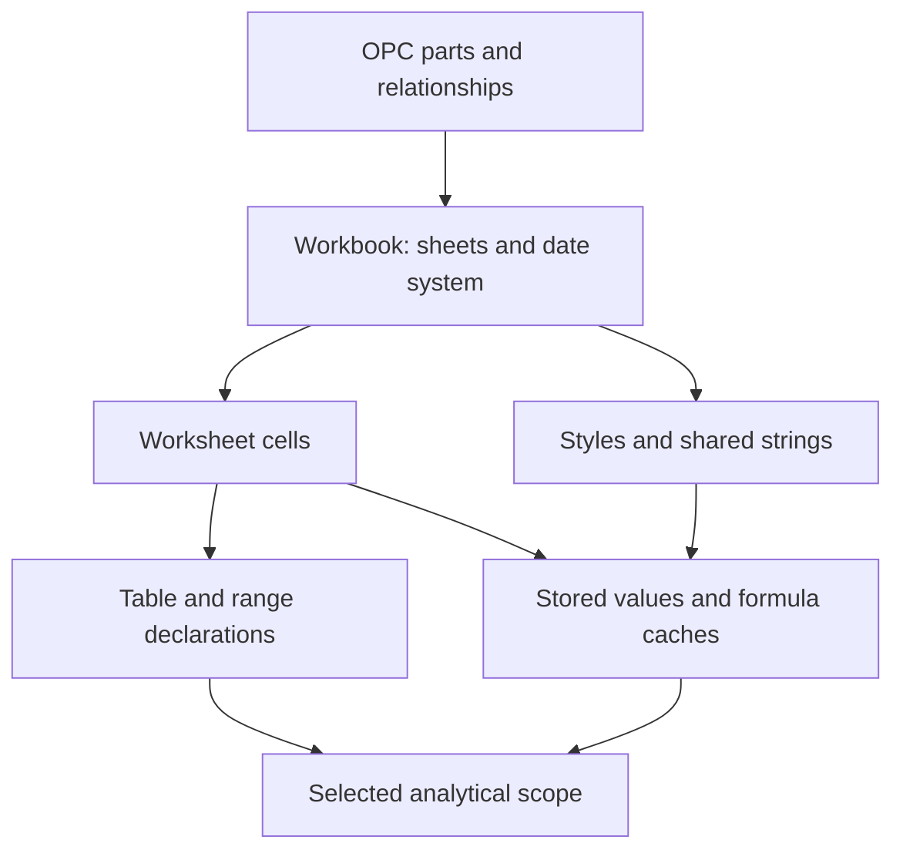

# Excel analysis architecture: findings and recommendations

Assessment date: 2026-10-22. Runtime reviewed: commit
[`50070b6`](https://github.com/sezzlee/mcp/commit/50070b604fdd70518d17356973a99694c0055c42),
including the retained-result foundation in [draft PR #62](https://github.com/sezzlee/mcp/pull/62).

This document records code inspection, a small real MCP probe and proposed follow-ups.
It does not implement the proposals or certify full Excel compatibility. The [package README](README.md)
defines current behavior; the root [roadmap](../../../ROADMAP.md#excel-analysis-and-typed-data)
owns future sequencing. Historical lab results are identified separately from this review.

## Recommendation

Keep the existing reader and analytical engine. Improve numerical integrity, source/schema
agreement and the agent's shortest useful route before expanding the tool catalogue. Continue
to calculate over the complete selected scope in the environment and return bounded evidence.
Use a retained result when the agent needs another operation over that completed calculation.

The review found a reproducible numerical defect in the shared derived-metric path: a total
across finite group sums can overflow and produce a misleading zero share. This remains
unfixed by this documentation addition. Treat its correction as the first correctness gate;
the passing payment scenario does not cover it. See the reproduction below.

| Priority | Smallest useful change                                                                     | Existing tool or new surface?                                               | Required evidence                                                                                                 |
| -------- | ------------------------------------------------------------------------------------------ | --------------------------------------------------------------------------- | ----------------------------------------------------------------------------------------------------------------- |
| P0       | Check additive totals and every derived arithmetic stage for non-finite values             | Repair `aggregate_sheet` internals                                          | Independent extreme-value expectations through inline and retained MCP calls; explicit refusal before publication |
| P0       | Teach the agent lab about result dependencies and completeness                             | Existing test/replay infrastructure                                         | Replayed handles bind to the new instance; a preview cannot satisfy a whole-table oracle                          |
| P1       | Bind discovered interpretations to a source version; expose compact calculation provenance | Extend existing source tools                                                | An explicitly expected version cannot silently select newer content                                               |
| P1       | Offer cheaper, focused discovery and exact declared table-body facts                       | Extend `describe_workbook` and `get_tables`                                 | Unselected sheets need no cell materialization; counts agree with table selection                                 |
| P1       | Support stable sorting, then selected typed predicates on retained rows                    | Extend `query_result`                                                       | Full matching result sorted before paging, with deterministic ties and bounded workspace                          |
| P2       | Reuse complete-scope type decisions                                                        | Internal cache, no new tool                                                 | Same interpretations and diagnostics, version/scope invalidation, measured benefit                                |
| P2       | Preserve and query individual filtered records                                             | A narrow row-query tool is justified if corpus tasks need it                | Duplicates and source row identity survive filtering, projection and retention                                    |
| P2       | Release an unneeded retained result early                                                  | A small lifecycle tool is justified if four live entries constrain sessions | Instance ownership, predictable missing-ID behavior and immediate capacity recovery                               |
| Later    | Row-level expressions, multiple sources and richer result algebra                          | Extend only after contracts and task evidence                               | Correct grain, units, provenance and resource ownership                                                           |

`context-mode` is useful inspiration for [keeping large tool data outside the conversation][context-mode].
For Excel, the retained object must preserve complete structured numeric results. Retrieving
a few relevant text passages cannot establish an exact sum or percentile. KV-cache reuse
does not remove newly returned evidence from the model's context.

## 1. The architecture that already exists

The five layers are enforced by [lint import rules](oxlint.config.ts), not merely directory
names. The four root entrypoints remain `cli.ts`, `index.ts`, `server.ts` and `regex-worker.ts`.

| Owner                                                    | Current responsibility                                                                                                           | Where a proposed change belongs                                                                                 |
| -------------------------------------------------------- | -------------------------------------------------------------------------------------------------------------------------------- | --------------------------------------------------------------------------------------------------------------- |
| `platform/`, backed by `file-core` and its native module | Authorized root access, file identity, size gates, document storage, errors and redaction; the boundary to Node and shared cores | Version propagation, cache admission and source access remain here; no direct filesystem shortcut in a new tool |
| `metadata/`                                              | SpreadsheetML part readers and report shapes: relationships, tables, names, styles, formula facts, drawings and rich values      | Scoped names, calculation hints, table-body facts and bounded structural diagnostics                            |
| `format/`                                                | CSV/OOXML bytes become a `SheetView`; document format, workbook state and lazy worksheet materialization                         | Cheaper discovery, format-specific decoding and version-bound analysis memo ownership                           |
| `grid/`                                                  | Selection, headers, typed readings, filters, grouping, metric state and presentation over `SheetView`                            | Shared numeric checks, quality policies, row expressions and row selection; no OOXML or MCP knowledge           |
| `tools/` and server wiring                               | Closed MCP schemas, orchestration, mandatory guarded responses and instance-owned retained snapshots                             | Query operations, compact provenance, lifecycle and bounded response construction                               |

The ordinary source path is:

1. A tool resolves an authorized snapshot through the document store.
2. A format adapter supplies worksheet metadata or a `SheetView`.
3. Selection fixes the table/range, header, merge and visibility policy. Grid operations read
   and calculate over that selected scope under their work/state budgets.
4. Inline results are bounded for presentation. Retained aggregation captures all finalized
   rows before `maxGroups` and display-string shortening, then publishes a small preview.
5. Every emitted response passes the existing `json()` constructor and `guard()` gate.

`query_result` branches after step 4: it operates only on its owning instance's immutable
stored rows. It does not reopen, digest, parse or aggregate the workbook. This is different
from the parsed-file cache: [file-core's document store](../../cores/file-core/src/documents.ts)
still obtains a native digest when validating a candidate cache hit. Cached parsing does not
mean a source-based call has no file I/O. A read cursor validates the source version; a
retained handle intentionally continues its captured snapshot even after source changes.

Relevant implementation boundaries are [document loading](src/format/document.ts),
[the sheet interface](src/grid/sheet.ts), [selection](src/grid/select-sheet.ts),
[aggregation](src/grid/aggregate.ts), [retained queries](src/tools/retained-results.ts)
and [instance wiring](src/server.ts).

### Reuse these capabilities

`aggregate_sheet` already has typed filters, conditional metrics, calendar/numeric grouping,
multiple grouping sets, bounded pivots, exact percentiles, ordering, aggregate-derived ratios
and differences, and inline membership filters against another column. `profile_sheet`
already produces reusable column interpretations with explicit sampling limits. Header
previews already exist in discovery. An agent given a file and sufficient schema information
can aggregate directly; a mandatory open/session/profile sequence would add unnecessary calls.

`read_sheet` reads rectangular cells. Its `columns` argument controls interpretation; it is
not arbitrary projection. `find_in_sheet` locates matching cells. Neither is a general
filtered-record query. Grouping by every invoice field would merge duplicate records and is
not a safe substitute. This is the clearest possible reason for a future new data tool.

The present retained slice supports one non-pivot grouping and exact scalar equality,
projection and stable offset pages. It does not provide follow-up sorting, reaggregation,
joins, a formula engine or source editing. Its [scope and admission contract](README.md#continue-on-a-complete-aggregate-result)
already separate full calculation from preview; preserve that distinction.

## 2. Excel has several different schemas

An analytical decision needs agreement across three levels:

- **Package/cell structure:** which parts, relationships, cell types, styles, cached values
  and extensions were actually saved?
- **Dataset structure:** which table or region, header, data rows, hidden rows and merged
  cells belong to the requested records?
- **Analytical meaning:** which values are identifiers, amounts, currencies, dates or
  durations; what is the row grain; which exclusions and rounding policy are acceptable?

A worksheet's used rectangle does not define a business table. A cell's storage type does
not establish a uniform column type. A valid OOXML package does not establish that its saved
formula results are current. These are separate questions with separate evidence.

The relevant package structure follows [ECMA-376][ecma] and Microsoft's
[SpreadsheetML overview][structure]. This diagram shows relationships and value dependencies,
not the application's import graph:



### Structure-by-structure review

The current column below is based on source inspection and existing tests. The final column
is a proposed validation target, not a claim that a new schema-validation suite was run.

| Structure                                     | Current behavior and evidence                                                                                                                                                                                                                                                                                                                        | Consequence and focused validation                                                                                                                                                                                                                                                                            |
| --------------------------------------------- | ---------------------------------------------------------------------------------------------------------------------------------------------------------------------------------------------------------------------------------------------------------------------------------------------------------------------------------------------------- | ------------------------------------------------------------------------------------------------------------------------------------------------------------------------------------------------------------------------------------------------------------------------------------------------------------- |
| OPC parts and relationships                   | [Package reader](src/metadata/spreadsheetml/package.ts) follows related worksheet/style/shared-string paths. Both it and [the OOXML adapter](src/format/ooxml-workbook.ts) currently require `xl/workbook.xml`. [Layout tests](test/opc-layout.spec.ts) exercise related-part relocation.                                                            | Describe the supported layouts precisely. A future root-relationship traversal must preserve external-target/path checks. Related-part flexibility is not arbitrary workbook-root support.                                                                                                                    |
| Namespaces and compatibility branches         | Namespace-aware matching and normalization cover supported Strict namespaces. Compatibility branch selection is used in chart/drawing readers.                                                                                                                                                                                                       | Pin Transitional, Strict and extension profiles independently. Do not advertise full Strict or blanket worksheet `AlternateContent` support from namespace normalization alone.                                                                                                                               |
| Cell records and cross-part indices           | [Worksheet reader](src/metadata/spreadsheetml/worksheet.ts) and [cell adapter](src/format/ooxml-cell.ts) distinguish numeric, shared/inline/formula strings, booleans, errors and ISO dates. Missing shared-string references can become missing values; unknown styles fall back to General; duplicate coordinates resolve to the last stored cell. | Validate `r`, `t`, `s`, formula/value children and metadata references separately. Keep valid fixtures separate from malformed-but-tolerated fixtures. Add bounded missing-reference/duplicate diagnostics where they can change a calculation. [Cell schema][cell] defines different roles for these fields. |
| Shared and rich text                          | [Shared-string reader](src/metadata/spreadsheetml/shared-strings.ts) joins rich-text runs, excludes phonetic text and handles escapes; inline strings follow the cell path.                                                                                                                                                                          | Preserve semantic equality across shared, inline and rich-run encodings, whitespace and escapes. A shared-string index is not the text itself. [Shared-string structure][strings] explains the indirection.                                                                                                   |
| Styles and numeric meaning                    | [Styles](src/metadata/spreadsheetml/styles.ts) and grid readings extract supported number/date/time/duration/percentage/currency meaning; this is not a complete style renderer.                                                                                                                                                                     | Test stored value, interpreted value and displayed text separately. Formatting cannot establish exact decimal arithmetic or a consistent currency across the column. Retain [number-format meaning tests](test/number-format-meaning.spec.ts).                                                                |
| Formulas and cached values                    | [Formula reader](src/metadata/spreadsheetml/formula-text.ts) handles supported normal/shared/array text; shared references are translated. Saved values drive calculations. Data-table formulas are not reconstructed into a general executable expression.                                                                                          | Microsoft defines `v` as the [cached result from the last calculation][formulas]. Add cache-state evidence, never a freshness guarantee. Formula/cache counters describe stored occurrences before duplicate-coordinate resolution, not an independently certified count of logical cells.                    |
| Calculation properties and dependencies       | `calcPr`, calculation-chain and external-workbook dependency semantics are not currently used to establish freshness.                                                                                                                                                                                                                                | Report selected [calculation hints][calc-properties] with an explicit unknown freshness state. The [calculation chain][calc-chain] records prior calculation order, not a dependency graph or proof of fresh results. Recalculation needs a separate engine contract.                                         |
| Tables and filters                            | [Table metadata](src/metadata/tables.ts) and [selection](src/grid/select-sheet.ts) identify declared data bodies and exclude supported headers/totals. Visible-row policy uses saved hidden flags; it does not execute AutoFilter criteria.                                                                                                          | Tables describe a logical region whose [actual values remain in worksheet cells][tables]. Expose declared body range/count through existing metadata. Distinguish saved visibility, filter declarations, nonblank records and usable metric values.                                                           |
| Names and irregular regions                   | Defined names expose names/references but can lose sheet-local scope; [the existing limitation](src/metadata/support.ts) already reports incompleteness. Header detection is heuristic unless declarations or explicit arguments settle it.                                                                                                          | Preserve [`localSheetId` scope][defined-name] before using names as authoritative selectors. For multiple regions, provide bounded candidate evidence; require a selected region before claiming a business total.                                                                                            |
| Sparse cells, bounds and merges               | `SheetView` exposes populated rows; aggregation weights absent rows instead of walking the full rectangle. Actual bounds, declared dimensions and selected range have different purposes. Merge policies are explicit.                                                                                                                               | Test large declared dimensions with sparse cells, blank selected rows, merged headers and repeat/master semantics. Never infer a record count from the number of stored cell nodes.                                                                                                                           |
| Dates and time                                | [Date conversion](src/grid/excel-serial.ts) supports workbook date systems. The fictitious 1900-system serial 60 remains numeric rather than becoming a real date. Typed text uses explicit or inferred date/locale rules.                                                                                                                           | Keep [59/60/61 and 1904 tests](test/cell-date.spec.ts), local-wall-clock/offset distinctions and ambiguity warnings. Microsoft's [1900 compatibility explanation][date-bug] is evidence for the special case, not permission to invent a date.                                                                |
| Rich values, dynamic arrays and native pivots | Rich metadata has [independent provenance and verification](../../lab/excel-lab/RICH_VALUE_SOURCES.md). Saved array/spill values can be read; arrays are not executed. Native PivotTable support is reported as unavailable; `aggregate_sheet.pivotBy` is an independent analytical operation.                                                       | Validate supported metadata chains and error values separately. Do not treat a displayed pivot cache as a complete source dataset. For dynamic arrays, [MS-XLSX's `fCollapsed` flag][dynamic-array] must be ignored; it is not a completeness signal.                                                         |
| External content and formats                  | The advertised formats are `.xlsx`, `.xlsm` and `.csv`; there is no `.xls` or `.xlsb` reader. Reading an `.xlsm` does not run VBA, refresh links or execute Power Query.                                                                                                                                                                             | Document unsupported/unknown semantics without silently executing external content. CSV needs dialect, encoding and analytical-schema tests; OOXML XSD validation says nothing about it.                                                                                                                      |

Schema validation is useful at selected boundaries. It cannot replace the business-grain,
type, unit and numerical checks above. The existing reader should remain a bounded reader;
do not put a full document validator on every analytical request without measured need.

## 3. First gate: repair shared numerical finalization

The per-group metric implementation already uses compensated summation and finite-value
checks in [aggregate-metrics](src/grid/aggregate-metrics.ts). The gap is later:
[aggregate finalization](src/grid/aggregate.ts) sums finalized group values into total-scope
metrics using ordinary addition, and [derived evaluation](src/grid/derived.ts) checks the
final value without detecting every invalid intermediate.

### Reproduced through MCP at the reviewed commit

An original two-row CSV was generated temporarily, read through an MCP client connected to
the actual server with `InMemoryTransport`, and removed afterward:

```csv
Customer,Amount
A,1e308
B,1e308
```

The request was:

```json
{
  "name": "aggregate_sheet",
  "arguments": {
    "filePath": "overflow.csv",
    "groupBy": ["Customer"],
    "columns": [{ "column": "Amount", "type": "number", "decimal": "." }],
    "metrics": [{ "fn": "sum", "column": "Amount" }],
    "derived": [
      {
        "name": "share",
        "numerator": [{ "metric": 1 }],
        "denominator": [{ "metric": 1, "scope": "total" }]
      }
    ],
    "resultMode": "retained"
  }
}
```

Observed response excerpt, without an error or warning:

```json
{
  "rows": [
    ["A", 1e308, 0],
    ["B", 1e308, 0]
  ],
  "resultComplete": true,
  "sampled": false
}
```

Each group's sum is finite. Their combined JavaScript-number total becomes infinity;
dividing a finite group value by it produces the finite but incorrect share zero. The
independent mathematical expectation is one half for each group. Under the existing numeric
representation, an explicit numerical refusal is an acceptable first correction.

Reuse checked accumulation only for additive metric slots actually referenced by total-scope
derived terms, and validate term multiplication, addition, division, scaling and rounding
before exposing or retaining a result. Checking unused cross-group totals would incorrectly
reject the same two valid group sums when no total-scope calculation was requested; pin that
successful case too. Preserve the documented zero-denominator
warning, while making overflow distinguishable from missing input. Never publish a handle
after this failure. Cover inline and retained responses, cancellation-heavy sums, finite
groups whose total overflows, factor/scale overflow and rounding boundaries. This is a
shared grid fix, not a retained-store workaround or a reason to raise resource limits.

## 4. Improve existing tools before adding overlapping ones

### 4.1 Bind interpretations and provenance to the source

`SheetSource.stamp` already exists, read cursors use source identity, and retained responses
expose their captured version. Ordinary discovery/profile/inline analysis do not yet provide
a common optional expected-version contract for a multi-call workflow.

Expose a compact source version with schema-bearing responses and accept an optional expected
version on the source operation that uses those decisions. Reject a mismatch before applying
an old interpretation to a new snapshot. Use the existing identity and native access gates;
a version is evidence, not authorization. The opaque stamp incorporates resolved source path,
content digest and requested CSV delimiter/encoding variant. `modifiedAt` is compared separately
for parsed-cache reuse and is not part of the stamp. Test that a timestamp-only change preserves
the stamp for identical bytes at the same path/options, while another path or explicit CSV
variant can have a different stamp. Also test actual content changes between profile and
aggregate and preserve the distinct cursor/retained semantics.

Retained metadata currently records source scope, counts and diagnostics but not the complete
normalized calculation recipe. Store a bounded recipe covering selection, predicates,
metrics, explicit readings, merge/visibility and rounding policies. Return a compact identity
and decision-relevant summary; expose full detail only when requested. Account it in the
existing result capacity. A future multiple-source recipe needs one captured version per
source and explicit observation semantics, not a fictitious atomic cross-file snapshot.

Consider an opt-in quality policy integrated into the existing complete scan. A caller could
require refusal for specified participating-cell errors, unreadable amounts, ambiguous dates,
mixed currencies or missing formula caches. Keep current tolerant behavior explicit and
compatible. `resultComplete` describes completed execution; it does not prove that every
selected cell contributed a valid value or that a cached formula was freshly calculated.

### 4.2 Make discovery proportional to the question

[Current `describeOoxml`](src/format/ooxml-workbook.ts) calls `loaded.sheet(name)` for every
worksheet to obtain actual bounds, header previews and counts. Individual sheet loading is
lazy, but this discovery request materializes all those sheets. Workbook/shared-string/style
loading is already eager, and a cold call still reads the authorized source snapshot.

Offer a bounded workbook catalogue and selected-sheet detail through `describe_workbook`.
Choose the exact option after measuring representative multi-sheet tasks. Preserve current
defaults for compatibility. A shallow response must label uncomputed bounds/counts as unknown;
it must not relabel declared dimensions as actual populated data. Selected detail can retain
the useful existing header preview. This can avoid unrelated worksheet materialization; it
does not by itself deliver streaming input or zero-cost cold discovery.

Extend `get_tables` with exact declared data-body range and row count using the same helper
as table selection. Existing responses expose `ref`, `headerRow` and `totalsRow`, leaving the
agent to perform range arithmetic. Preserve explicit header/totals counts and refusal for
unsupported declarations. Test headerless, header-only, empty, totals-bearing and invalid
tables. A declared data row can be blank or hidden; this count is not a count of valid payments.
Factor shared declaration validation and body geometry without forcing metadata inspection
to adopt selection's current refusal of a zero-row body; define that metadata case explicitly.

### 4.3 Let a retained result answer a newly chosen ranking question

Add stable sorting to `query_result` before a broader result language. Sorting must consider
all matching stored rows before paging. Specify original column identity, supported value
types, null placement, original-row ordinal as the tie-breaker, and bounded sort/index memory.
Keep exact equality unchanged; then evaluate closed numeric comparisons and bounded membership
predicates against actual task frequency.

There is a numerical contract to settle first: the initial aggregate orders by unrounded
metric values, while retained rows contain finalized values including requested rounding.
A later sort can either order those stored scalars or retain separately accounted unrounded
keys. It cannot silently promise the same ranking as a fresh unrounded calculation. Include
near-equal values that round to ties in acceptance tests.

Current offsets are stable only for the same immutable result and query. Richer ordering
should bind continuation to a normalized query identity or a query-bound cursor, and reject
incompatible continuation. Test all pages for loss/repetition, reordered projections, ties,
nulls, Unicode labels, zero matches and targets beyond the initial preview. The current
response and guard budgets still apply.

### 4.4 Reuse complete-scope type decisions

Repeated source analysis can repeat separator/date-order inference even when parsing is
cached. The [roadmap's typed-text measurements](../../../ROADMAP.md#excel-analysis-and-typed-data)
are historical evidence for investigating this cost; they were not rerun for this review.

A bounded memo should key the source version and dialect, sheet/range, selected columns,
requested reading kinds, locale/tokens/explicit types and relevant visibility/merge policy.
Store compact decisions and diagnostics, not another raw workbook. Do not reuse a sampled
profile as proof of a complete-range inference decision: its reusable columns express a
chosen interpretation, while the subsequent calculation still validates participating data.
Prove unchanged results and ambiguity reporting before measuring latency and memory benefits.

## 5. When a new tool is justified

### Filtered record queries

A proposed row-query surface would select/filter/project source records while preserving
duplicates and source row identity, and optionally retain the complete bounded result. It
would reuse `SheetView`, typed readings, selection, predicate semantics and existing source
guards. It should expose the same distinctions between scanned, matching, stored and returned
rows, with an explicit blank-row/visibility policy.

This fills a different need from grouped analysis: an agent may need the invoices underlying
a total, including two identical invoice records. Add it only with independent corpus tasks
demonstrating the gap. Generalize the current aggregate-specific retained metadata when this
second producer exists; avoid building a universal workspace framework in advance. The name
and final schema remain proposals.

### Early release

The current store admits four live results, uses absolute fifteen-minute expiry and refuses
admission when full. An instance-owned release operation could free an unneeded result
immediately. It changes ephemeral server state, not a workbook; annotations and missing-ID
semantics still need an explicit contract. Keep foreign-instance IDs unreadable, preserve the
root authority and verify that released capacity is reusable. Do not introduce persistence
or a tenant system to solve this small lifecycle problem.

### Row arithmetic and richer analysis

Existing `derived` already computes differences, ratios and shares of aggregate metrics.
The real missing expression is often row-aligned: `sum(quantity × unitPrice)` or `Paid < Amount`.
For records `(2, 10)` and `(3, 20)`, the product sum is independently `80`; multiplying column
sums gives `150`. A closed typed expression integrated into the existing scan can address
this without `eval`, SQL execution or arbitrary JavaScript.

Specify missing operands, errors, units, currency and per-row versus final rounding before
implementation. Compensated binary floating point is not exact decimal accounting. A corpus
requirement for exact money arithmetic needs a separate precision/rounding contract.

Reaggregation of finalized retained rows also needs algebraic honesty: averaging averages,
adding distinct counts or merging percentiles does not generally recover a source-level
metric. Either define the operation as analysis of the materialized table, or retain the
necessary mergeable state and weights under a new budget. Joins additionally require key
cardinality, duplicate/unmatched-row semantics and multiple-source provenance. These are
later designs, as are formula execution, writing and export.

## 6. The agent's shortest useful route

These are logical call paths, not measured latency improvements. Necessary discovery depends
on what the user supplied. A fair baseline must not give itself undisclosed headers or ranges.

| Information and question                                                 | Useful current route                                                                                                                             | What a proposed change improves                                          |
| ------------------------------------------------------------------------ | ------------------------------------------------------------------------------------------------------------------------------------------------ | ------------------------------------------------------------------------ |
| File, region and relevant columns are known                              | One `aggregate_sheet` call                                                                                                                       | No preliminary open/read/profile requirement                             |
| File is known; relevant sheet/header is unknown                          | `describe_workbook`, then aggregate if its bounded header preview supplies the needed schema; otherwise focused read/profile or table inspection | Focused discovery avoids unrelated cell materialization                  |
| File is unknown in the authorized workspace                              | `list_workbooks`, then necessary discovery and aggregate                                                                                         | Keep discovery in the measured baseline                                  |
| Selected columns have uncertain text types                               | `profile_sheet`, review reusable readings, then aggregate                                                                                        | Expected-version binding prevents accidental reuse after source changes  |
| Top five is the question from the outset                                 | Inline aggregate with metric ordering and `maxGroups: 5`                                                                                         | Existing full calculation already answers this with bounded output       |
| A retained analysis needs one specific customer                          | `query_result` with exact equality                                                                                                               | Already avoids all source I/O and returning every customer               |
| A new ranking is requested after a differently ordered retained analysis | Currently source reanalysis or retrieval of result pages                                                                                         | Full-result sort can answer from the stored snapshot                     |
| Individual filtered records are needed                                   | Current rectangular reads and cell search require extra orchestration                                                                            | A bounded row query can preserve records and return only relevant fields |

The payment scenario deliberately exercises discovery and reads every page to prove coverage.
It is a verification sequence. An agent answering only the `C1200` follow-up should use the
selective lookup; reading every result page would add unnecessary context.

## 7. Context and resource economics

This review measured the actual `client.listTools()` tool array at the reviewed commit:

| Measurement                    | Observed value | Scope                                                                                        |
| ------------------------------ | -------------- | -------------------------------------------------------------------------------------------- |
| Registered tools               | 13             | Current server, including `query_result`                                                     |
| `JSON.stringify(tools).length` | 35,778         | JavaScript UTF-16 code units                                                                 |
| UTF-8 serialized bytes         | 35,791         | Same tool array; excludes transport framing                                                  |
| Existing catalogue gate        | 36,000         | [The test](test/tool-schema.spec.ts) uses string `.length`, despite describing a byte budget |

Only 222 code units remain under that gate. A new tool or repeated argument schema has a
measurable catalogue cost before any workbook is opened. Clarify the gate's units and track
UTF-8 bytes separately; do not casually increase its bound. Shorter descriptions must retain
the information needed to avoid wrong calls. Measure actual model input counts when a model
is available; these character/byte counts are not token counts.
The model runner transforms these definitions into host function descriptors and adds a
task-specific `submit_answer` tool; its complete schema payload must be measured separately.

For responses, distinguish model-facing text bytes, serialized `CallToolResult` bytes and
the host's complete model request with schemas/history. The existing scenario records the
first two. Reducing repeated metadata can help, but retain calculation completeness, current
query coverage, warnings, original column identity and continuation. Original diagnostic
counters describe the stored calculation, not a newly recalculated filtered subset.

Preserve the [existing purpose-based limit classification](README.md#why-existing-limits-stay-in-place):
input/expansion/visit/state limits protect processing; post-calculation presentation limits
protect context; profile/read/report bounds can protect both. Sorting, inference memoization
and additional retained producers add work/state that must be accounted separately. A smaller
preview cannot justify a larger scan or store. The current 16 KiB retained page, result/store
capacity, source access, redaction and common payload gate remain constraints.

## 8. Validation: structural evidence through actual agent behavior

### Extend the existing fixture and protocol infrastructure

Use the current [raw workbook builder](test/fixtures/raw-workbook.ts),
[cell parity tests](test/ooxml-cells-parity.spec.ts),
[rich-value provenance](../../lab/excel-lab/RICH_VALUE_SOURCES.md),
[typed boundary tests](test/typed-reading-boundaries.spec.ts) and
[MCP result scenario](../../lab/excel-lab/src/result-scenario.ts). A new general benchmark
service or committed private corpus is unnecessary.

The raw workbook builder produces controlled parser fixtures, not automatically conformant
packages: its current content-type declarations are incomplete, and its `strict` option does
not change relationship type URIs to Strict. Complete and validate package declarations and
the selected namespace/relationship profile before promoting a fixture to a conformance example.

For a feature fixture, record producer/version, format profile, feature intent, independent
expected values, relevant relationship/index invariants, validator version/result and the
MCP assertion it supports. Distinguish intentionally invalid parser-hardening inputs from
valid conformance examples. Existing rich fixtures already document external validation;
reuse that provenance rather than claiming all fixtures were recalculated in Excel.

| Evidence level                        | Proposed check                                                                                                                                         | What it cannot establish alone                                    |
| ------------------------------------- | ------------------------------------------------------------------------------------------------------------------------------------------------------ | ----------------------------------------------------------------- |
| Container/parser safety               | Existing archive/XML/native limits, malformed references and bounded diagnostics                                                                       | Correct business totals                                           |
| Versioned structural validation       | Selected Strict/Transitional/extension fixtures against pinned schema/tool profiles; optionally a development-only [Open XML SDK validator][validator] | Formula recalculation or complete Excel application compatibility |
| Cross-part and semantic expectations  | Independent checks of relationship targets, cell/style/string indices, date system, table boundaries and formula-cache presence                        | Whether the selected region answers the user's business question  |
| Real MCP calculation and continuation | Independent expected totals/rows, refusal cases, complete-result lookup and every-page coverage                                                        | Whether a model selects the right operation                       |
| Corpus and model trials               | Pinned task knowledge, corpus hashes, server build, catalogue, prompt/model and host usage                                                             | General success outside the measured tasks                        |

ECMA-376 has separately versioned parts; pin the actual profile rather than labeling every
SpreadsheetML rule with the OPC part's publication year. Schema-valid input can still contain
stale cached values or the wrong business scope. This review compared selected structures
with primary documentation; it did not run a comprehensive XSD/SDK validation campaign.

Useful equivalent-meaning fixtures include namespace-prefix changes, supported related-part
relocation, shared versus inline/rich text, and equivalent dates under 1900/1904 systems.
Compare sparse and explicitly blank encodings within the same selected scope, allowing
documented differences in storage and declared-bound metadata. Expectations must come from independent constants or a separate
oracle. Do not calculate expected output with the pipeline under test.

### Make the agent lab handle-aware before evaluating this workflow

The new result scenario binds handles correctly, but the broader agent harness still has
specific gaps:

- [Baseline execution](../../lab/excel-lab/src/agent/baseline.ts) sends static planned arguments.
  Add a narrow typed reference to a prior successful step's result field, not executable expressions.
  Validate references as plan metadata in the task catalogue, then validate resolved arguments
  against the unchanged MCP input schema before invocation.
- [Replay](../../lab/excel-lab/src/agent/replay.ts) remaps cursors, not retained IDs. Bind recorded
  IDs to newly produced IDs and normalize volatile expiry values. A failed/diverged producer
  must block dependent steps. Do not mask source versions, completeness or actual data changes.
- [Row derivation](../../lab/excel-lab/src/agent/derive.ts) rejects `truncated: true`, but a retained
  preview uses `preview`/`hasMore` instead. Whole-table oracles must require complete coverage of
  the requested matching scope. A complete one-row lookup can be valid while `totalRows` is large.
- [Trace attribution](../../lab/excel-lab/src/agent/exercised.ts) mainly associates calls by
  `filePath`. Track result-to-producer/source lineage so result queries and lifecycle failures
  receive correct attribution.
- Baseline, model-run and replay drivers currently share a server across tasks or trials.
  Isolate independent tasks' retained state, preferably with a fresh instance over the same
  workspace; keep one instance within deliberate multi-turn/lifecycle tasks. Pin cold/warm
  cache policy when comparing timing so isolation does not quietly change the experiment.

Acceptance must include a tempting answer in an incomplete preview, filtered complete
lookups, multiple pages with consistent query/columns/version, new-instance replay and failed
producers. A terminal page with `hasMore: false` and a nonzero offset cannot independently
satisfy a whole-table oracle: coverage must start at zero and account for every matching row.
Add retained tasks to the model catalogue only after their independent scripted
baseline passes. Historical [lab findings](../../lab/excel-lab/FINDINGS.md) and model smoke runs
predate several current improvements; their old call counts and schema sizes are not current
measurements. The new deterministic scenario does not measure agent success either.
Verify that at least five independent retained tasks succeed, while a fifth live result
within one explicit lifecycle task still receives the intended capacity refusal.

### Existing entry points

Run from the repository root; Turbo builds dependencies before the tests or scenario:

```bash
pnpm turbo run test --filter=@sezzlee/excel-mcp --filter=@sezzlee/excel-lab --ui=stream
pnpm turbo run result-scenario --filter=@sezzlee/excel-lab --ui=stream -- --out /tmp/excel-results
pnpm turbo run result-scenario --filter=@sezzlee/excel-lab --ui=stream -- --root /path/to/workbooks --scenario /path/to/overdue-scenario.json --out /tmp/excel-corpus-results
```

The [lab README](../../lab/excel-lab/README.md#use-your-own-corpus) defines the external
`scenario.json`, independent expectations, exact tool calls and measurement scope. Keep user
files outside the repository. The structural validation and handle-aware model-harness work
above are proposals, not additional commands that already exist.

## 9. Decisions for the next increment

Correctness comes first: repair the reproduced derived overflow, then make the harness unable
to confuse preview evidence with complete data. Follow with small existing-tool improvements
whose acceptance cases can be demonstrated without a model. Measure real model behavior once
the protocol baseline is trustworthy.

The user's corpus and agent trials should resolve these questions:

1. Are wrong answers caused by source-region selection, type inference, stale formula caches,
   arithmetic, model planning or interpretation of a bounded response?
2. Does a typical follow-up need ranking, numeric filtering or individual source records?
   Which extension removes the most repeated source work and returned data?
3. Does the agent choose retained mode when continuation helps, while keeping simple one-shot
   questions inline? Can it distinguish calculation completeness from returned-page coverage?
4. Which quality exclusions should refuse an answer, and which should remain visible warnings?
   Are exact decimal money semantics or row-level products actually required?
5. Is the existing header preview enough for wide/multi-region sheets? Does shallow/focused
   discovery reduce measured work without forcing extra recovery calls?
6. Are four live results and fixed fifteen-minute expiry practical? Would early release solve
   the observed pressure, or is another measured lifecycle policy needed?
7. Does reducing catalogue or repeated metadata text improve correctness and total request
   size, or merely move cost into extra tool calls?

Compare correctness first, then calls, complete serialized bytes, elapsed time and explicitly
scoped memory. Use host-reported token counts only when available. No token-saving percentage,
latency gain or agent-success rate is inferred from this review.
Reuse the existing [agent-lab run/compare workflow](../../lab/excel-lab/AGENT_LAB.md) and
[paired experiments](../../lab/excel-lab/src/agent/experiment.ts): declare treatment changes,
pair repeated trials by task/language/repetition, and use the same eligible pairs for each metric.

[context-mode]: https://github.com/mksglu/context-mode
[ecma]: https://ecma-international.org/publications-and-standards/standards/ecma-376/
[structure]: https://learn.microsoft.com/en-us/office/open-xml/spreadsheet/structure-of-a-spreadsheetml-document
[cell]: https://learn.microsoft.com/en-us/dotnet/api/documentformat.openxml.spreadsheet.cell?view=openxml-3.0.1
[strings]: https://learn.microsoft.com/en-us/office/open-xml/spreadsheet/working-with-the-shared-string-table
[formulas]: https://learn.microsoft.com/en-us/office/open-xml/spreadsheet/working-with-formulas
[calc-properties]: https://learn.microsoft.com/en-us/dotnet/api/documentformat.openxml.spreadsheet.calculationproperties?view=openxml-3.0.1
[calc-chain]: https://learn.microsoft.com/en-us/office/open-xml/spreadsheet/working-with-the-calculation-chain
[tables]: https://learn.microsoft.com/en-us/office/open-xml/spreadsheet/working-with-tables
[defined-name]: https://learn.microsoft.com/en-us/dotnet/api/documentformat.openxml.spreadsheet.definedname?view=openxml-3.0.1
[date-bug]: https://learn.microsoft.com/en-us/troubleshoot/microsoft-365-apps/excel/wrongly-assumes-1900-is-leap-year
[dynamic-array]: https://learn.microsoft.com/en-us/openspecs/office_standards/ms-xlsx/d1ef676d-d970-4ddd-b642-62f5e0c291e0
[validator]: https://learn.microsoft.com/en-us/dotnet/api/documentformat.openxml.validation.openxmlvalidator?view=openxml-3.0.1
